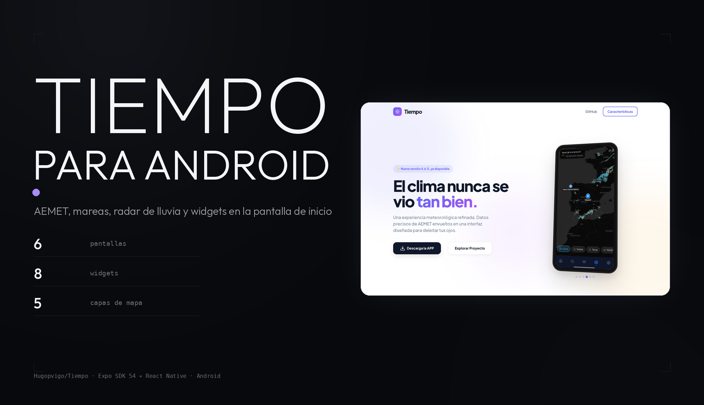
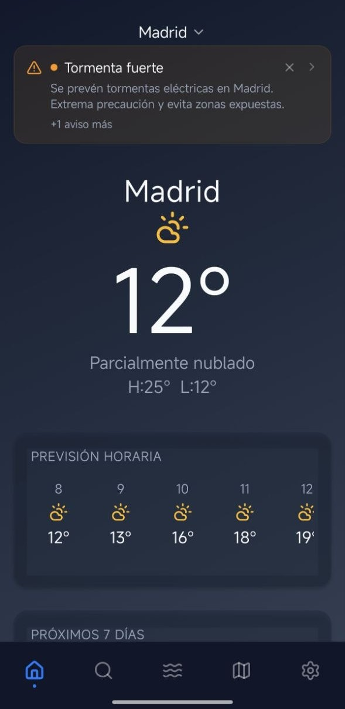
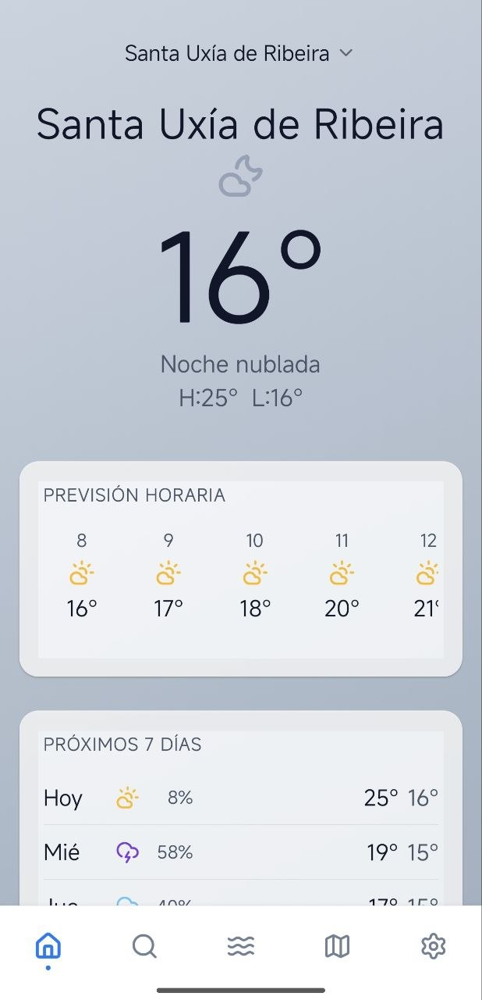
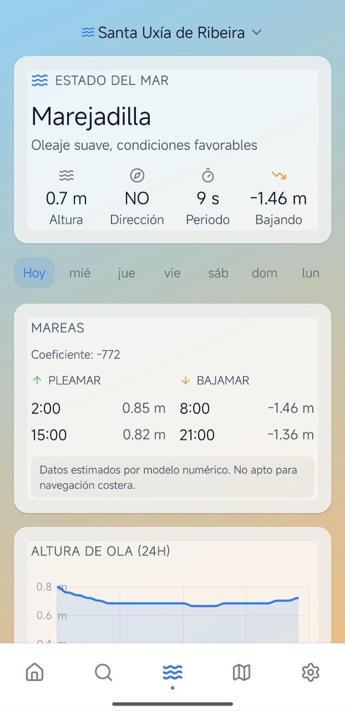
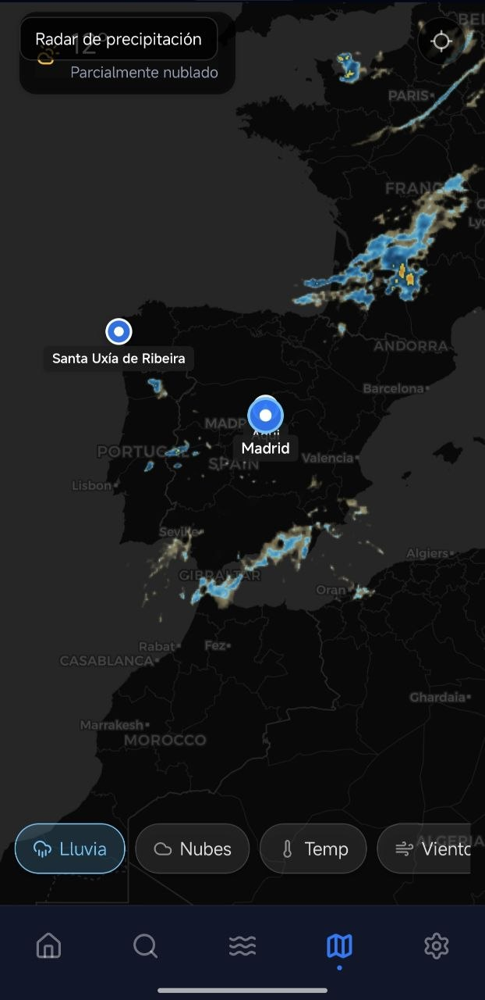
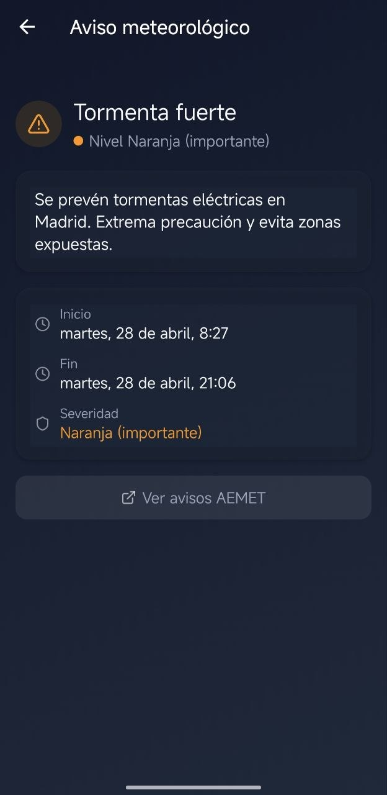
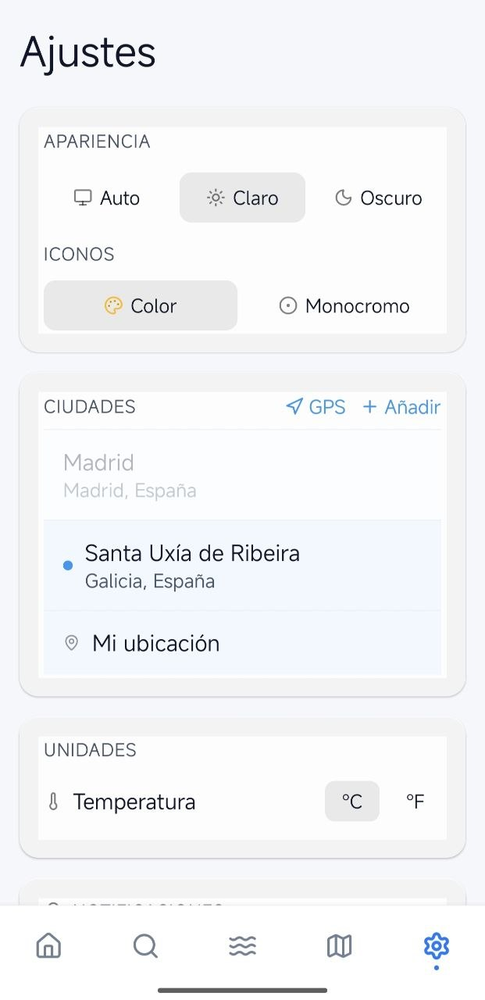

<p align="center">
  
</p>

<p align="center">
  <b>Una app del tiempo para Android: previsión global de Open-Meteo y avisos oficiales de la AEMET.</b><br>
  Mareas, radar de lluvia, calidad del aire, fase lunar y widgets en la pantalla de inicio.
</p>

<p align="center">
  <a href="https://hugopvigo.github.io/Tiempo/"></a>
  
  
  
</p>

---

## Qué es esto

Este repositorio contiene **dos cosas** que van juntas:

1. **`tiempo-app/`** — la app de Android, escrita en React Native con Expo
   (TypeScript). Es la parte principal del proyecto.
2. **La raíz** — la web estática que la presenta: la landing que ves al abrir
   el repositorio y que enlaza con la descarga.

La app muestra el tiempo de cualquier ciudad guardada (o de tu posición
actual), con los avisos oficiales de la **AEMET** cuando hay clave API
configurada, y con la cobertura global de **Open-Meteo** siempre disponible.

> La previsión (actual, horaria y a 7 días) viene de **Open-Meteo**. La AEMET
> aporta los **avisos oficiales**, no los datos de la previsión.

| | |
|---|---|
|  |  |
| Modo oscuro: fondo degradado, banner de alerta y previsión horaria. | Modo claro: misma pantalla con el aspecto invertido. |

## Qué hace

| | |
|---|---|
|  |  |
| Mareas: estado del mar, pleamar y bajamar, y altura de ola en 24 h. | Mapa con el radar de precipitación y cinco capas disponibles. |

| | |
|---|---|
|  |  |
| Detalle de un aviso oficial de la AEMET, con inicio, fin y severidad. | Ajustes: tema, iconos, ciudades guardadas y claves API. |

- **Previsión** — actual, por horas (24 h) y a 7 días, con gráfico SVG de
  probabilidad de lluvia.
- **Mareas** — estado del mar, indicador de marea subiendo o bajando, horarios
  de pleamar y bajamar y gráfico de altura de ola. Los datos salen de la Open-Meteo
  Marine API; la app detecta si la ciudad es costera o interior.
- **Alertas oficiales** — avisos de la AEMET (lluvia, tormenta, nieve, viento,
  calor, frío, costera) con el área y la subzona exactas. Cuando hay clave de
  AEMET, sus avisos sustituyen a los locales del mismo tipo.
- **Mapa** — radar de lluvia con línea de tiempo de frames (reproducción,
  pausa y arrastre), satélite infrarrojo de nubes y capas de temperatura,
  viento y presión.
- **Calidad del aire** — índice EAQI europeo, con el detalle de PM2.5, PM10,
  O3 y NO2, más el polen de gramíneas, olivo y abedul.
- **Fase lunar** — las 8 fases dibujadas con SVG, con iluminación, orto y
  ocaso, calculados en local sin API externa.
- **Widgets de pantalla de inicio** — tiempo actual, reloj + tiempo, previsión
  de 5 días y gráfica de lluvia: 4 tipos de widget, 8 variantes registradas
  (con y sin fondo). Redimensionables al ancho completo y con actualización en
  segundo plano cada 30 minutos.
- **Notificaciones** — avisos meteorológicos en segundo plano, con interruptor
  por tipo (lluvia, tormenta, nieve, viento, calor, frío, costera, niebla).
- **Ciudades** — buscador con autocompletado y almacenamiento local con MMKV.

## Las APIs que usa

| API | Qué trae | ¿Necesita clave? |
|---|---|---|
| **Open-Meteo** | previsión global y Marina (oleaje y mareas) | No |
| **Open-Meteo Air Quality** | EAQI, partículas y polen | No |
| **Open-Meteo Geocoding** | buscador de ciudades | No |
| **RainViewer** | tiles de radar de precipitación y de satélite infrarrojo | No |
| **AEMET OpenData** | avisos oficiales por comunidad y zona | Sí (en Ajustes) |
| **OpenWeatherMap** | tiles de temperatura, viento y presión | Sí (en Ajustes) |

Las dos claves se pueden meter **desde Ajustes → Claves API**, sin recompilar:
se guardan en el almacenamiento local y la app valida la clave al escribirla.

- Clave gratuita de AEMET: [opendata.aemet.es](https://opendata.aemet.es/centrodedescargas/inicio)
- Clave de OpenWeatherMap: [openweathermap.org](https://home.openweathermap.org/users/sign_up)

## Ponerlo en marcha

```bash
git clone https://github.com/Hugopvigo/Tiempo.git
cd Tiempo/tiempo-app
npm install
npm run android        # abre en un dispositivo o emulador Android
```

Otros scripts:

```bash
npm start              # Metro, para desarrollo
npm run ios            # en iOS
npm run web            # en el navegador
npm run lint           # ESLint
```

### Compilar la APK

El proyecto usa [EAS Build](https://docs.expo.dev/build/introduction/) y
tiene tres perfiles en `tiempo-app/eas.json`:

```bash
cd tiempo-app
npm run build:preview     # APK de preview, distribución interna
npm run build:prod        # app-bundle para producción
```

Las últimas APKs publicadas están en la
[página de releases](https://github.com/Hugopvigo/Tiempo/releases).

> **Estado de las versiones:** la última APK publicada es la **v4.2**
> (release `Version_4.2`, asset `App_Tiempo_Version_4_2.apk`). El código del
> repositorio va por la **v4.6.1** (`tiempo-app/package.json`), que todavía no
> está compilada ni subida como release. El botón de descarga de la landing
> enlaza por eso a la v4.2.

## Cómo está hecho

| Capa | Tecnología |
|---|---|
| Core | [Expo SDK 54](https://expo.dev) + React Native 0.81 |
| Lenguaje | TypeScript 5.9 |
| Navegación | [Expo Router](https://docs.expo.dev/router/introduction/) (por ficheros) |
| Estilos | [NativeWind v4](https://www.nativewind.dev) (Tailwind CSS) |
| Estado | [Zustand](https://github.com/pmndrs/zustand) + [TanStack Query v5](https://tanstack.com/query/latest) |
| Animaciones | [Reanimated 4](https://docs.swmansion.com/react-native-reanimated/) + `react-native-svg` |
| Persistencia | [MMKV](https://github.com/mrousavy/react-native-mmkv) |
| Iconos | [Lucide React Native](https://lucide.dev) |
| Mapas | Leaflet dentro de un `WebView` + [RainViewer](https://www.rainviewer.com/api.html) |

El mapa es Leaflet 1.9.4 dentro de un WebView: se le pasa el HTML del mapa por
`source={{ html }}` y la app recibe los toques de los marcadores por
`postMessage`.

## Estructura

```
Tiempo/
├── index.html          ← landing estática (la web de la raíz)
├── style.css
├── script.js           ← carrusel de capturas y blobs del fondo
├── tiempo-app/
│   ├── app/            ← rutas de Expo Router (inicio, buscar, mareas, mapa, ajustes, alerta)
│   ├── components/     ← weather, tides, map, city, alerts, theme, ui
│   ├── constants/      ← tema, traducción de códigos meteorológicos, zonas AEMET
│   ├── hooks/          ← useWeather, useTides, useAirQuality, useLunarPhase, useAlerts…
│   ├── services/       ← clientes de API (AEMET, Open-Meteo, RainViewer)
│   ├── stores/         ← Zustand + MMKV
│   ├── utils/          ← cálculo lunar y detección de ciudades costeras
│   ├── widgets/        ← los widgets de pantalla de inicio
│   ├── types/
│   └── assets/         ← iconos y capturas de la app
├── CHANGELOG.md
├── plan.md
└── docs/capturas/
```

## Licencia

El código de este repositorio está bajo **CC BY-NC-SA 4.0**: compartir con
atribución, sin uso comercial, y las derivadas bajo la misma licencia. Ver
[LICENSE](LICENSE).
